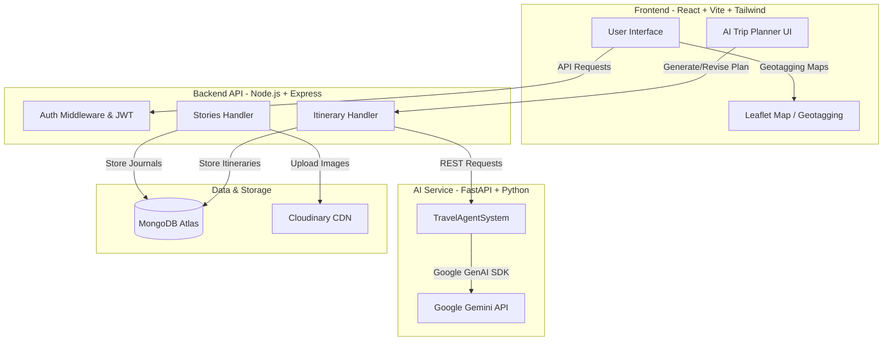

# 🗺️ Travel Mate & Story App

Travel Mate is a full-stack web application designed for travel enthusiasts to document their journeys, view public/private travel journals, geotag destinations, and generate customized travel itineraries using AI. 

Built using a modern multi-service architecture: **React & Tailwind CSS** for the frontend, **Node.js, Express & MongoDB** for the core backend, and a **FastAPI & Google Gemini** powered AI Service for intelligent trip planning.

---

## 🚀 Key Features

*   **👥 User Authentication:** Secure signup, login, and password reset flows powered by JSON Web Tokens (JWT) and SMTP email support.
*   **📖 Travel Journal (Stories):** Add, view, edit, and delete travel stories with text, dates, images, and geolocation metadata. Mark stories as favorites and filter them by search or date.
*   **🌍 Interactive Map & Geotagging:** Integrated Leaflet maps to mark, visualize, and view stories geographically on an interactive map.
*   **🤖 AI Trip Planner:** Powered by Google Gemini (`gemini-2.5-flash`), generate complete, budget-optimized travel plans based on duration, interests, destination, and budget.
*   **💬 Conversational Plan Revisions:** Iteratively refine generated itineraries by sending feedback (e.g., *"make it more relaxed"* or *"remove venue X"*). The agent maintains conversation memory (summarized buffer) to respect long-term constraints.
*   **☁️ Cloud Storage:** Seamless integration with Cloudinary for handling image uploads.

---

## 🏗️ System Architecture



---

## 📂 Project Structure

```
Travel-story-app/
├── backend/                  # Node.js/Express Core Backend
│   ├── assets/               # Static assets & placeholder images
│   ├── models/               # Mongoose schemas (User, Story, Itinerary)
│   ├── scripts/              # Migration scripts (local uploads -> Cloudinary)
│   ├── cloudinary.js         # Cloudinary configuration & helpers
│   ├── config.js             # Environment config loader
│   ├── index.js              # Express app entry point & routes
│   ├── multer.js             # Multipart/form-data upload middleware
│   ├── geocoding.js          # Geolocation handlers
│   └── utilities.js          # Authentication & token verification helpers
│
├── frontend/                 # Vite-based React Frontend
│   ├── public/               # Public assets
│   ├── src/
│   │   ├── assets/           # UI icons and images
│   │   ├── components/       # Reusable layout & UI components
│   │   ├── pages/            # Page components (Home, Auth, Landing, AI-planner)
│   │   └── utils/            # Axios instance, helpers, and constants
│   ├── tailwind.config.js    # Tailwind CSS layout config
│   └── vite.config.js        # Vite bundler config
│
└── ai-service/               # Python-based FastAPI AI Agent Service
    ├── main.py               # FastAPI router and server entry
    ├── agents.py             # LangChain/Gemini LLM agent and prompt templates
    ├── tools.py              # Auxiliary tools for the AI agent
    └── requirements.txt      # Python dependencies
```

---

## 🛠️ Getting Started

### Setup Instructions

#### 1. Backend Setup (Node.js/Express)
1. Navigate to the backend directory:
   ```bash
   cd backend
   ```
2. Install dependencies:
   ```bash
   npm install
   ```
3. Create your environment configuration file:
   ```bash
   cp .env.example .env
   ```
4. Fill in the required environment variables in `.env` (refer to the [Environment Variables](#environment-variables) table).
5. Start the backend server:
   *   **Development mode (auto-reload):** `npm run dev`
   *   **Production mode:** `npm start`
   *   *The API will be available at:* `http://localhost:8000`

#### 2. AI Service Setup (FastAPI)
1. Navigate to the AI service directory:
   ```bash
   cd ai-service
   ```
2. Create and activate a Python virtual environment:
   ```bash
   python -m venv venv
   # On Windows (CMD/PowerShell):
   .\venv\Scripts\activate
   # On macOS/Linux:
   source venv/bin/activate
   ```
3. Install requirements:
   ```bash
   pip install -r requirements.txt
   ```
4. Configure your environment variables:
   ```bash
   cp .env.example .env
   ```
5. Edit `.env` and insert your `GOOGLE_API_KEY`.
6. Start the FastAPI server:
   ```bash
   python -m uvicorn main:app --host 0.0.0.0 --port 8001
   ```
   *The AI service will run at:* `http://localhost:8001`

#### 3. Frontend Setup (React/Vite)
1. Navigate to the frontend directory:
   ```bash
   cd frontend
   ```
2. Install dependencies:
   ```bash
   npm install
   ```
3. Create your environment configuration file:
   ```bash
   cp .env.example .env
   ```
4. Start the development server:
   ```bash
   npm run dev
   ```
   *The client application will run at:* `http://localhost:5173`

---

## 🔑 Environment Variables

### Core Backend (`backend/.env`)
| Variable | Description | Example / Default |
| :--- | :--- | :--- |
| `PORT` | Local port for Express API | `8000` |
| `ACCESS_TOKEN_SECRET` | Secret token used to sign JSON Web Tokens | *Generate a secure random string* |
| `MONGO_URI` | Connection URI for MongoDB | `mongodb+srv://...` or `mongodb://localhost:27017/travel-app` |
| `BASE_URL` | Public endpoint for the backend API | `http://localhost:8000` |
| `FRONTEND_URL` | Endpoint of the frontend client (for password resets) | `http://localhost:5173` |
| `CLOUDINARY_CLOUD_NAME` | Cloudinary credentials name | `your_cloud_name` |
| `CLOUDINARY_API_KEY` | Cloudinary public API key | `your_api_key` |
| `CLOUDINARY_API_SECRET` | Cloudinary private API secret | `your_api_secret` |
| `AI_SERVICE_URL` | URL of the Python FastAPI service | `http://localhost:8001` |
| `SMTP_USER` | SMTP username for forgot password emails *(optional)* | `example@gmail.com` |
| `SMTP_PASS` | SMTP application password *(optional)* | `abcd efgh ijkl mnop` |

### AI Service (`ai-service/.env`)
| Variable | Description | Example / Default |
| :--- | :--- | :--- |
| `GOOGLE_API_KEY` | Gemini Pro / Flash API Key | `AIzaSy...` (from Google AI Studio) |
| `GEMINI_MODEL` | Gemini Model version used for planning | `gemini-2.5-flash` |

### Frontend (`frontend/.env`)
| Variable | Description | Example / Default |
| :--- | :--- | :--- |
| `VITE_API_URL` | Core backend API URL endpoint | `http://localhost:8000` |

---

## 🛠️ Tech Stack

*   **Frontend Client:** React (Vite), Tailwind CSS, Axios, React Leaflet (Map visualization), React Toastify.
*   **Core Backend:** Node.js, Express, MongoDB & Mongoose ORM, Multer & Cloudinary (Filesystem upload handler).
*   **AI Engine:** FastAPI (Python), Uvicorn, Pydantic, Google GenAI SDK (`gemini-2.5-flash`).
